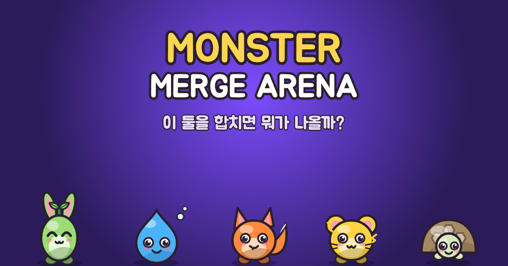

# Monster Merge Arena

> 이 둘을 합치면 뭐가 나올까? — 3분 동안 몬스터를 합성해 팀을 만들고 몰려오는 적을 막아내는 캐주얼 디펜스.

**플레이:** https://breton5797.github.io/monster-merge-arena/ (모바일 세로 화면 권장, 홈 화면에 추가하면 앱처럼 실행·오프라인 플레이)



## 게임 소개

- **드래그 합성** — 같은 몬스터는 ★강화, 서로 다른 몬스터는 레시피가 있으면 새 몬스터, 없으면 키메라.
- **45종 도감** — 기본 14 · 합성 30 · 키메라 1. 미발견 몬스터는 실루엣과 속성 테두리로 힌트.
- **3분 단판** — 4레인 자동 전투, 20초마다 보상 3택, 5속성 상성(불→풀→바위→번개→물→불).
- **6스테이지 + 보스 2종** — 스테이지마다 ★1~3 평가, 매일 바뀌는 **오늘의 도전**(같은 날 모두 같은 시드).

## 개발

```bash
npm install
npm run dev        # 개발 서버
npm test           # 단위·통합 테스트 (Vitest)
npm run e2e        # E2E (Playwright, 프로덕션 빌드를 모바일 화면으로)
npm run sim        # 무작위 합성 봇 밸런스 시뮬레이션 (스테이지별 승률)
npm run build      # 프로덕션 빌드 → dist/ (PWA 서비스워커 포함)
npm run assets     # 앱 아이콘·공유 이미지 재생성 (캐릭터 SVG → PNG)
```

`main` 브랜치에 push하면 GitHub Actions가 테스트 → 빌드 → GitHub Pages 배포를 수행한다.

URL 옵션: `?debug=1` (이벤트 로그, 몬스터 소환 패널, F키 4배속), `?debug=1&bot=1` (봇 자동 플레이).

## 구조

| 경로 | 내용 |
|---|---|
| `src/data/*.json` | 모든 수치·콘텐츠 (몬스터, 레시피, 적, 스테이지, 캐릭터 아트 스펙, 전역 설정) |
| `src/systems/` | Phaser와 분리된 게임 로직 — 전투 모델(`Battle.ts`), 합성, 3택, 웨이브, 스킬 28종 |
| `src/art/` | 코드로 그리는 SVG 캐릭터·아이콘·배경 (부팅 시 텍스처로 래스터화) |
| `src/scenes/`, `src/views/` | Phaser 화면 |
| `src/services/` | 저장, 분석 이벤트, 효과음·배경음악(Web Audio 합성), 진동, 광고·결제 인터페이스 |

기술: Phaser 3.90 · TypeScript(strict) · Vite · Vitest · Playwright · vite-plugin-pwa
